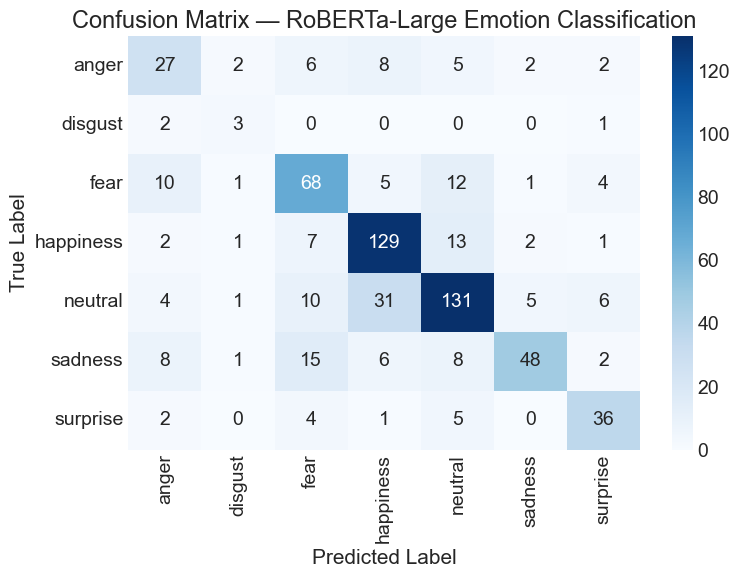

# Emotion Classification Pipeline (NLP)

An end-to-end NLP pipeline that takes a **TV episode's audio**, transcribes it, translates it, and **classifies the emotion of every sentence** into 7 classes (happiness, sadness, anger, fear, surprise, disgust, neutral).
Built as a team of three for a media-analytics client, using transcripts from the reality show *Australian Survivor*.

```
Video / audio ──► Speech-to-text ──► Translation ──► Emotion classifier ──► Timestamped emotions (CSV)
                  (AssemblyAI,        (custom EN↔NL     (RoBERTa-Large,
                   Whisper)            BART model)       class-weighted)
```

**Highlights**

- Compared **15+ models**, from TF-IDF baselines to RNNs/LSTMs, fine-tuned **transformers** and **LLM prompt engineering**
- Best model: **class-weighted RoBERTa-Large**, with **69.3 % accuracy / 0.63 macro-F1** on a heavily imbalanced 7-class test set
- Speech-to-text evaluated by **word error rate**: AssemblyAI 3.8 %, Whisper-small 5.0 %
- Trained an **English↔Dutch translation model** (~120M-parameter BART) from scratch: **BLEU ≈ 29, chrF2 ≈ 47**
- Error analysis, **explainable AI** (Gradient × Input, LRP, input perturbation) and a **model card**

**Tech stack:** Python · PyTorch · Hugging Face Transformers · TensorFlow/Keras · scikit-learn · NLTK · VADER · AssemblyAI · Whisper · sacrebleu

---

## Results

### Emotion classification (test set)

| Model | Accuracy | Macro-F1 |
|---|---|---|
| Logistic Regression (TF-IDF) | 0.38 | 0.24 |
| SVM (TF-IDF + bigrams + sentiment + POS) | 0.39 | 0.29 |
| BERT-base | 0.588 | 0.483 |
| RoBERTa-base | 0.616 | 0.561 |
| RoBERTa-base + VADER features | 0.613 | 0.588 |
| RoBERTa-Large | 0.672 | 0.596 |
| **RoBERTa-Large + class-weighted loss** | **0.693** | **0.632** |
| DeBERTa-v3-Large (weighted) | 0.654 | 0.549 |



**What we learned**
- **Class weighting mattered more than model size.** It gave the biggest jump on rare emotions like disgust and surprise.
- **Data relevance beats data size.** Classical models trained on a smaller 24K dataset that *matched the test style* scored much higher (macro-F1 0.42) than on a larger 70K dataset from a different domain (0.29).
- The hardest confusions are **neutral ↔ happiness** and **sadness ↔ fear**, emotions that often overlap in real conversation.

| Emotion distribution (imbalanced) | Best classical model (SVM) |
|---|---|
|  |  |

### Other pipeline components

| Component | Approach | Result |
|---|---|---|
| Speech-to-text | AssemblyAI vs. Whisper-small, evaluated by word error rate | WER **3.84 %** vs. **5.02 %** |
| Machine translation | BART-style seq2seq trained on cleaned OpenSubtitles EN–NL, plus a domain glossary | BLEU **≈ 29.3**, chrF2 **≈ 47.2** |
| Prompt engineering | Zero-shot → dynamic few-shot retrieval, JSON output, neutral fallback, calibration | Macro-F1 0.61 (zero-shot) → **0.40–0.45 on held-out test** |

---

## Repository structure

| Folder | Contents |
|---|---|
| [`1-speech-to-text/`](1-speech-to-text/) | AssemblyAI and Whisper transcription scripts and outputs |
| [`2-nlp-features/`](2-nlp-features/) | POS tagging, TF-IDF, sentiment and embedding features |
| [`3-data-quality/`](3-data-quality/) | Data quality report: profile, class balance, domain checks |
| [`4-models/`](4-models/) | Traditional ML, RNN, LSTM and transformer iterations, plus the iteration log |
| [`5-prompt-engineering/`](5-prompt-engineering/) | Three iterations of LLM-based emotion classification |
| [`6-translation-and-pipeline/`](6-translation-and-pipeline/) | EN↔NL translation model training and the final end-to-end pipeline |
| [`7-error-analysis-and-xai/`](7-error-analysis-and-xai/) | Error analysis and explainable-AI notebooks and reports |
| [`docs/`](docs/) | [Full project report](docs/project_report.md), [model card](docs/model_card.md), final presentation |

Every step is documented in detail, with all intermediate results, in the **[full project report](docs/project_report.md)**.

## How to run

```bash
conda env create -f environment.yml
jupyter notebook
```

- The AssemblyAI script reads its key from the `ASSEMBLYAI_API_KEY` environment variable.
- The prompt-engineering notebooks expect your own LLM API key (`LLM_API_KEY`).
- The raw transcript datasets and the trained model checkpoints (several GB) are not included.

---

## Team & my contribution

Built by a team of three: **Ahmed Ali Alezabi**, Abdelrahman Samara and Barsam Talebi Garakouei.

**My main contributions:**
- Speech-to-text and word-error-rate evaluation
- Data quality report
- Traditional ML models (Logistic Regression, Naive Bayes, SVM, with feature engineering)
- **Transformer fine-tuning, including the best model (class-weighted RoBERTa-Large)**
- Error analysis and the model card
- Most of the project documentation (I made the most commits in the original team repository)

*This is a cleaned copy of our team's original repository, published with my teammates' permission. API keys and the client's raw datasets have been removed.*

---

Built in Year 2 of the Applied Data Science & AI programme at Breda University of Applied Sciences.
**Author:** Ahmed Ali Alezabi · [GitHub](https://github.com/AhmedAlezabi1)
