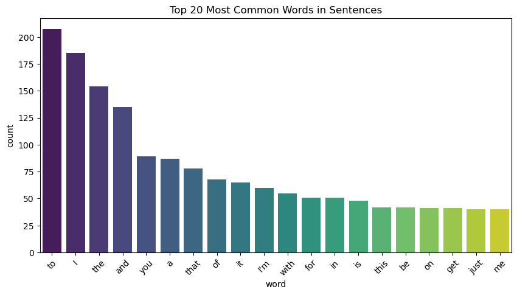
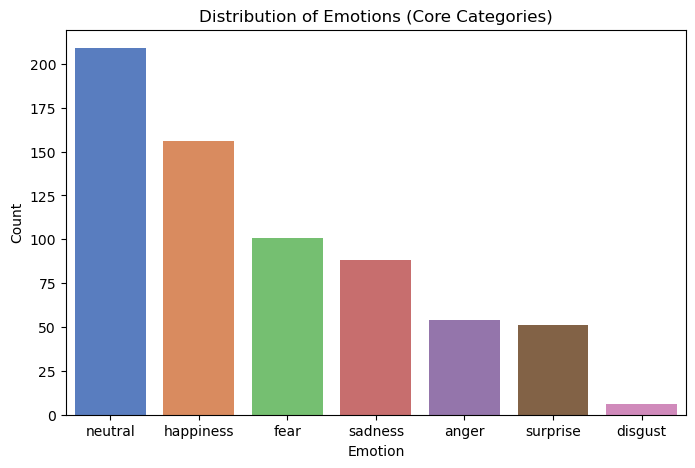
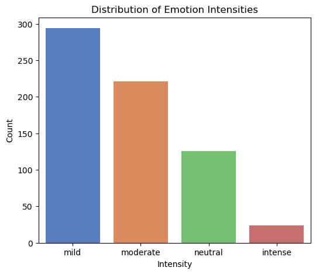
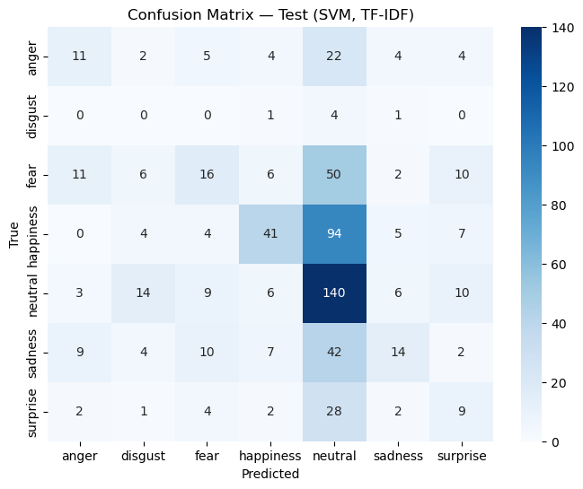
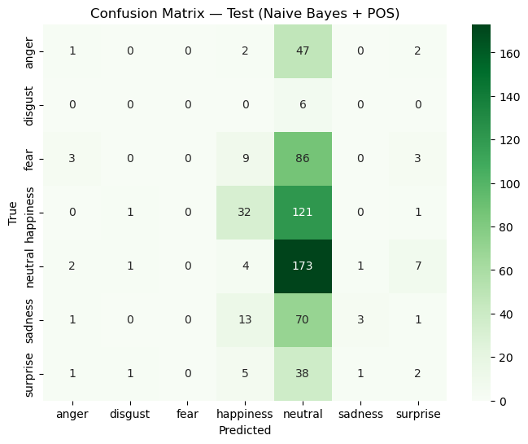
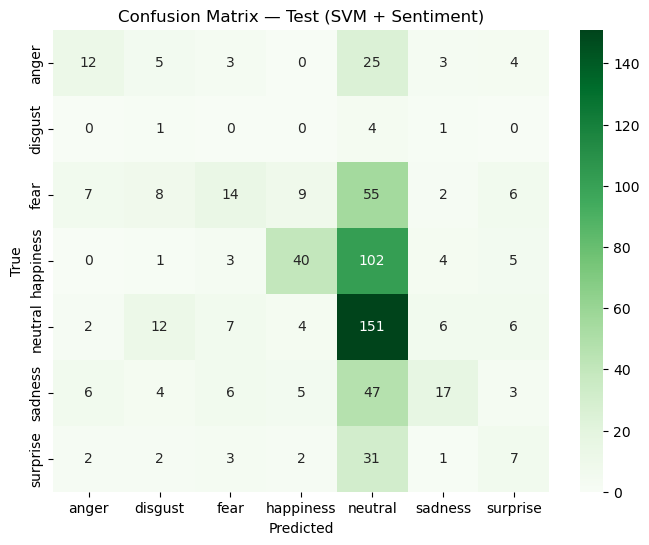
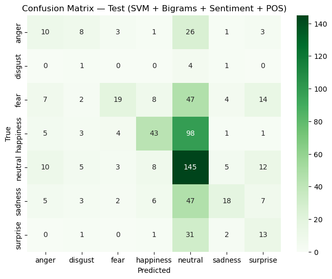

# Emotion Classification: Full Project Report

Detailed write-up of every step. For the summary, see the [main README](../README.md).

## 1. Speech to Text
**Task summary:**  

Use AssemblyAI and Whisper to transcribe a YouTube video (in your own language). Extract audio using `pytubefix`, transcribe it, split into sentences, and save each model’s output in a file with one sentence per row.

#### Documentation

We used AssemblyAI and Whisper to transcribe a YouTube video in our own language. We extracted the audio using pytubefix, processed it through both models, split the transcribed text into sentences, and saved the output in files with one sentence per row.

##### What We Did:
##### AssemblyAI:

Created speech_to_text_assemblyAI.py.
The script takes an MP3 audio file as input, transcribes it using AssemblyAI, and extracts the text.
Text is split into sentences using punctuation (., !, ?) and cleaned to remove empty lines.
Saved the output in transcribed_data_assemblyAI.xlsx.

##### Whisper:

Created speech_to_text_whisper.py.
The script takes an MP3 audio file, transcribes it using Whisper (small model), and extracts the full text.
Used NLTK’s sent_tokenize to split the transcription into sentences.
Saved the output in transcribed_data_whisper.csv.
Linked all scripts and output files in our GitHub repository for review.

**Deliverables:**
- [speech_to_text_assemblyAI.py](../1-speech-to-text/speech_to_text_assemblyAI.py)
- [transcribed_data_assemblyAI.csv](../1-speech-to-text/transcribed_data_assemblyAI.xlsx)
- [speech_to_text_whisper.py](../1-speech-to-text/speech_to_text_whisper.py)
- [transcribed_data_whisper.csv](../1-speech-to-text/transcribed_data_whisper.csv)

---

## 2. Word Error Rate (WER)
**Task summary:**  

Evaluate transcription accuracy by calculating WER between Whisper and AssemblyAI outputs. Use first 180/240 lines, manually mark substitutions (S), insertions (I), and deletions (D).

#### Documentation:

#### 1- WER Calculation for AssemblyAI  
Given: 
- Substitutions (S): 24  
- Insertions (I): 17  
- Deletions (D): 15  
- Original word count: 1459 (for 180 lines)  

We calculated the Word Error Rate (WER) for AssemblyAI by following these steps:

Step 1: Calculate Total Errors**  
First, we added up all the error types (substitutions, insertions, and deletions):
- Total Errors = S + I + D = 24 + 17 + 15 = 56

Step 2: Adjust N (according to the standard formula)**  
Then we adjusted the original word count using the standard WER formula:
- Adjusted N = Original word count + Deletions - Insertions
- Adjusted N = 1459 + 15 - 17 = 1457

Step 3: Calculate WER**  
Finally, we calculated the WER as a percentage:
- WER = (S + I + D) / N × 100%
- WER = 56 / 1457 × 100% = 3.84%

**Result:**
- **AssemblyAI WER = 3.84%**  
> Most commercial ASR systems aim for WER rates under 5–10%, so 3.84% indicates that AssemblyAI performed well.

#### 2- WER Calculation for Whisper (small) 

Given:  
- Substitutions (S): 54  
- Insertions (I): 22  
- Deletions (D): 5  
- Original word count: 1631 (for 180 lines)  

We then calculated the WER for Whisper using the same method:

Step 1: Calculate Total Errors**
First, we summed all the errors:
- Total Errors = S + I + D = 54 + 22 + 5 = 81

Step 2: Adjust N (according to the standard formula)**  
Next, we adjusted the word count:
- Adjusted N = Original word count + Deletions - Insertions
- Adjusted N = 1631 + 5 - 22 = 1614

Step 3: Calculate WER**  
Then we calculated the final WER percentage:
- WER = (S + I + D) / N × 100%
- WER = 81 / 1614 × 100% = 5.02%

**Result:**  
- **Whisper (small) WER = 5.02%**
> Compared to the reported WER scores in Table 13 of *Robust Speech Recognition via Large-Scale Weak Supervision* (Radford et al., 2023), where Whisper Small achieved 6.1% on English, our Whisper transcript performed better with a WER of 5.02%.
> 
**Deliverables:**
- [STT_Assembly.csv](../1-speech-to-text/STT_Assembly.xlsx)
- [STT_Whisper.csv](../1-speech-to-text/STT_Whisper.xlsx)

---

## 3. NLP Features Extraction
**Task summary:**  
Extract NLP features from your transcript data:
- POS tagging
- TF-IDF
- Sentiment score
- Pretrained word embeddings
- Custom-trained word embeddings (domain-specific)
- One additional NLP feature of your choice

#### Documentation - NLP Feature Extraction  

#### Goal  
As a team, we created a notebook called **NLP_features.ipynb** to extract different linguistic features from the *Australian Survivor* transcripts. For this phase, we focused on **POS tagging** and **TF-IDF features**.  

#### What We Did  

#### 1. POS Tagging  
- Used **spaCy** to assign **Part-of-Speech (POS)** tags to each word in a sentence.  
- This helps us understand the grammatical structure of the text.  
**Example:**  
`"Previously on Australian Survivor"`  
`['ADV', 'ADP', 'PROPN', 'PROPN']`  

#### 2. TF-IDF (Important Words per Sentence)  
- Applied **scikit-learn’s TfidfVectorizer** (max 1000 features, stopwords removed).  
- Each sentence was transformed into a vector of numerical scores that show how important each word is in that sentence relative to all sentences.  

**Example feature words:**  
`['allies', 'australian', 'bad', 'blindside', 'breaks', 'breakup']`  

**Example TF-IDF vector (first 5 values):**  
`[0.0, 0.577, 0.0, 0.0, 0.0]`  

#### Results  
Each of the 10 sentences now has:  
- Original text  
- POS tags  
- TF-IDF vector  

**Deliverables:**
- [NLP_features.ipynb](../2-nlp-features/NLP_features.ipynb)
- [NLP_features.csv](../2-nlp-features/NLP_features.csv) (first 10 rows)

---

## 4. Data Quality Report
**Task summary:**  
Analyze our transcript data to assess:
- Dataset size, duplicates, missing values
- Emotion distribution
- TV speech characteristics
- Transcription/translation issues
- Data quality insights for training data selection

Use visuals and summary metrics to guide model development.

**Documentation:**

#### Step 1: Load Data
- We loaded the dataset into a pandas DataFrame.  
- We confirmed that all columns (Start Time, End Time, Sentence, Translation, Emotion_fine, Emotion_core, Intensity) were present.  

#### Step 2: Dataset Profile
- We calculated the total number of rows → **665 sentences**.  
- We checked for missing values → **none found**.  
- We checked for duplicates → **none found**.  
- We calculated sentence length:
  - **Average length** ≈ 8.6 words.  
  - **Shortest sentence** = 1 word (e.g., "I", "Yeah").  
  - **Longest sentence** = 26 words.  
- We calculated the vocabulary size → **1294 unique words**.  
- We checked token distribution:
  - The most frequent tokens were common words like **"to", "I", "the", "and", "you"**.  
  - These words show the conversational style of the data.  
  - Emotion words are much less frequent. 
  

#### Step 3: Emotion Distribution
- We counted how many times each emotion label (Emotion_core) appears.  

| Emotion    | Count |
|------------|-------|
| Neutral    | 209   |
| Happiness  | 156   |
| Fear       | 101   |
| Sadness    | 88    |
| Anger      | 54    |
| Surprise   | 51    |
| Disgust    | 6     |

- We plotted the distribution in a bar chart.  
- **Result:** The dataset is **imbalanced**. Neutral and Happiness are the most frequent emotions, while Disgust is very rare.  

#### Step 4: Domain Characteristics
- **Fillers & hesitations:** *um* = 1, *hmm* = 1, *you know* = 9, **like** = 35 → some informality but fewer disfluencies than natural speech.
- **Interruptions:** Ellipses (`...`) = 4, dashes (`--`) = 0 → transcripts appear **cleaner/polished**.
- **Slang/colloquialisms:** *gonna* = 22, *ain’t* = 1; little variety otherwise (*wanna*, *gotta* absent).
- **Artifacts:** **1** encoding issue detected (`©`); **0** double spaces.

#### Step 5: Data Quality Checks
- **Label consistency:** Manual spot-checks per emotion looked **mostly consistent** (some expected noise).
- **Misspellings:** Naive spell-check over-flags punctuation/names; after token cleaning, **true misspellings were rare**.
- **Encoding/transcription issues:** Confirmed **1** replacement-character issue; otherwise clean formatting.
- **Imbalance:** Reconfirmed **emotion imbalance** (see Step 3).
- **Intensity distribution:** Computed and visualized; consider balancing intensities if skewed.

#### Step 6: Reflection for Training Data Selection
Based on the analysis, the following points guide training data needs:

- **Emotional balance:** The dataset is skewed toward *neutral* (31.4%) and *happiness* (23.5%), while emotions like *disgust* (0.9%) and *surprise* (7.7%) are rare. Training data should include more examples of underrepresented emotions to prevent model bias.

- **Spoken language features:** The transcripts include some informal markers (e.g., "like", "gonna") but have very few fillers, hesitations, or interruptions. To capture authentic TV dialogue, additional data with more disfluencies and overlapping speech would be beneficial.

- **Domain coverage:** Current data is limited to one show/genre. To avoid overfitting, training data should span different TV genres (drama, reality, comedy, documentaries) and multiple contexts of spoken language.

- **Transcription quality:** Only minor artifacts (encoding issues, rare misspellings) were detected. This is positive, but to make models robust, training data should also include noisier transcripts that reflect real-world imperfections.

- **Intensity levels:** If certain intensities (e.g., *intense*) are underrepresented, training data should include balanced examples across mild, moderate, and intense expressions.

- **Summary:** To train a robust emotion detection model for TV dialogue, supplementary data should emphasize:
1. Better balance across emotions and intensities.  
2. Inclusion of more naturalistic spoken features (fillers, hesitations, interruptions).  
3. Coverage across diverse TV genres and varied speakers.  
4. A mix of clean and noisy transcripts to ensure generalization.

**Deliverables:**
- [Data_quality_report.ipynb](../3-data-quality/data_quality_report.ipynb)

---

## 5. Model Iterations
**Task summary:**  
Train and evaluate emotion classification models using traditional and deep learning techniques:
- Logistic Regression
- Naive Bayes
- SVM
- LSTM
- RNN
- 2 Transformer models (e.g. BERT and one other)

Use at least 3 different NLP features (from Task 4) across models and track all experiments.

#### Documentation

#### 1- Logistic Regression (Baseline)

For our first baseline model, we trained a **Logistic Regression** classifier using **TF-IDF features** extracted from the cleaned transcripts.  

Why Logistic Regression?
- It is a simple but effective model for text classification.  
- Easy to train and interpret.  
- Provides a strong baseline before testing more complex models.  

Data Cleaning
Before training, we prepared the data as follows:
- Kept only the **Sentence** and **Emotion** columns.  
- Dropped missing values and duplicate rows.  
- Normalized emotion labels (e.g., changed *joy* → *happiness*).  
- Removed weird characters (like `Â`).  
- Converted text to **lowercase**.  
- Removed URLs and non-letter characters.  
- Removed extra spaces. 
  
Data Setup
- Training set: 41,849 sentences  
- Validation set: 10,463 sentences  
- Test set: 638 sentences  
- Features: TF-IDF with 23,564 dimensions  

Results
- **Validation Macro-F1:** 0.45  
- **Test Macro-F1:** 0.24  
- **Accuracy (test):** 0.38  

Observations
- The model predicted **Neutral** and **Happiness** relatively well.  
- Rare emotions like **Disgust** and **Fear** performed poorly due to data imbalance.  
- Many sentences from **Anger, Sadness, and Surprise** were misclassified as Neutral.  

Conclusion
- Logistic Regression with TF-IDF is a good starting point, but its performance is limited by the **imbalanced dataset** and the lack of deeper semantic understanding.  
- We will improve results by experimenting with **Naive Bayes, SVM**, and later deep learning models (LSTM, RNN, Transformers), and by adding more features (sentiment, POS tags, embeddings).
---------------
#### 2 - Naive Bayes (TF-IDF baseline)

Why: Classic, fast text baseline to compare against Logistic and SVM.

Data & Features
- Train: 41,849 • Val: 10,463 • Test: 638
- Features: TF-IDF (vocabulary = 23,564 terms)
- Labels: 7 emotions (neutral is most frequent; disgust is very rare)

Model & Params
- `MultinomialNB` with Laplace smoothing
- Final run: `alpha = 1.0` (trained on Train+Val, evaluated on Test)

Results
- **Validation macro-F1:** 0.187  
- **Test macro-F1:** 0.103  
- **Test accuracy:** 0.326

Observations
- Strong bias toward **neutral** (very high recall on neutral, very low on rare classes).
- Some classes (e.g., **disgust**, **fear**) were **never predicted**, which triggers the sklearn
  `UndefinedMetricWarning` (precision set to 0 for those labels).
- Overall weaker than Logistic on this dataset due to **class imbalance** and NB’s bag-of-words assumptions.
- Naive Bayes assumes all words contribute independently (Bag of Words assumption).
- It struggles with:
- Context (e.g., “not happy” vs. “happy”).
- Rare classes (few training examples → unreliable probabilities).
- Imbalance (majority classes dominate likelihoods).
- Overall performance: Naive Bayes is weaker than Logistic Regression here.
- Logistic handles TF-IDF weights better and balances decisions more robustly.
  
 Conclusion
- Useful baseline, but insufficient alone. We’ll keep it for comparison and move on to SVM and feature-augmented models (sentiment, POS).
  
---------

#### 3 - Support Vector Machine (SVM) — TF-IDF Baseline

We trained a **Linear SVM** classifier using only TF-IDF features.  
After testing different values of `C`, the best results came with **C = 0.25** and `class_weight="balanced"` to handle class imbalance.

 Results (Validation set)
- **Macro-F1:** 0.423  
- Best performance on **happiness** and **neutral**.  
- Medium results for **fear, sadness, and anger**.  
- Weak for **disgust** and **surprise**, but slightly better than Naive Bayes.  

 Results (Test set)
- **Macro-F1:** 0.259  
- **Neutral** predicted well (recall 0.777) but often over-predicted.  
- **Happiness** okay (F1 ~0.37).  
- **Anger, Sadness, Fear, Surprise** often confused with neutral.  
- **Disgust** was not predicted at all (too few examples).  

Conclusion
- SVM gave the **best performance among traditional baselines** so far, beating both Logistic Regression and Naive Bayes.  
- However, the model still struggles with **rare emotions** because of class imbalance.  
- We will next try adding extra features (e.g., POS, sentiment) to improve results.

 Baseline summary (TF-IDF only)

| Model                | Features | Val Macro-F1 | Test Macro-F1 | Test Acc |
|----------------------|----------|--------------|---------------|----------|
| Logistic Regression  | TF-IDF   | 0.45     | 0.24          | 0.38     |
| Naive Bayes          | TF-IDF   | 0.19         | 0.10          | 0.33     |
| SVM (LinearSVC)      | TF-IDF   | 0.42         | 0.26     | 0.37     |

*Insight:*  
- **SVM** gave the strongest baseline performance overall, slightly better than Logistic.  
- **Naive Bayes** performed worst, heavily biased towards **neutral**.  
- All models struggled with **rare classes** (disgust, fear, surprise), showing the impact of class imbalance.  
  
------------------------------------------

#### Improved Baselines (TF-IDF + Extra Features)

#### 1 Logistic Regression + Sentiment (TF-IDF + VADER)

To improve the baseline Logistic Regression, we combined **TF-IDF word features** with **4 sentiment scores** (`neg`, `neu`, `pos`, `compound`) from VADER.

Validation Results
- Accuracy: 0.567  
- Macro-F1:0.449  

Per class:
- Good: happiness, neutral (many samples).  
- Moderate: anger, sadness (improved recall compared to baseline).  
- Still weak: fear, disgust, surprise (low recall).  

Test Results
- Accuracy:0.398  
- Macro-F1: 0.273  

Per class: 
- Neutral predicted best (high recall, but low precision).  
- Happiness improved slightly with sentiment cues.  
- Disgust & fear remain very weak due to very few examples.  
- Model still often collapses predictions into *neutral*.  

Insights
- Adding **sentiment features** gave a small boost on validation (macro-F1 ~0.45 → 0.449, similar).  
- On the **test set**, performance improved slightly:  
  - **Baseline Logistic (TF-IDF): 0.24**  
  - **Logistic + Sentiment: 0.27**  
- This shows sentiment helps the model make better distinctions (especially for negative emotions like anger/sadness), but the gain is limited because the dataset is **imbalanced** and minority classes (fear, disgust, surprise) remain underrepresented.  
- Stronger models (e.g., RNNs, Transformers) or richer features (POS tags, embeddings) will likely be needed to reach the 0.75 goal.

-------------------------------

#### 2 Naive Bayes ( TF-ID + POS features) 

We added part-of-speech ratios (NOUN, VERB, ADJ, PRON) to the TF-IDF features and trained Naive Bayes.

Results
- Validation: Macro-F1 = 0.237, Accuracy = 0.51  
- Test: Macro-F1 = 0.132, Accuracy = 0.33  

Findings
- The model predicts neutral very often (recall = 0.92 in test).  
- Minority classes (fear, disgust, surprise) are almost never predicted.  
- POS features alone are too weak for Naive Bayes — the model defaults to majority classes.  
  
Reflection
- Adding POS features did not improve performance compared to Logistic Regression.  
- Naive Bayes struggles with imbalanced datasets and rare features.  
- Logistic Regression made better use of extra features (like sentiment).  

- --------------------------------------------

#### 3 SVM (TF-IDF + Sentiment)
 

We combined TF-IDF with VADER sentiment scores and trained SVM.

Results
- Validation: Macro-F1 = 0.427, Accuracy = 0.536  
- Test: Macro-F1 = 0.269, Accuracy = 0.379  

Findings
- Neutral is predicted strongly (recall = 0.80 on test).  
- Happiness recall improved compared to SVM baseline.  
- Minority classes (disgust, fear, surprise) remain weak but slightly better than with TF-IDF alone.  
- Overall, sentiment features gave SVM a small but consistent improvement.  

Insights

- **Logistic Regression + Sentiment** performed best overall.  
- **SVM + Sentiment** was competitive, achieving similar test macro-F1.  
- **Naive Bayes + POS** showed little benefit; POS features were too weak.  
- Adding features (sentiment/POS) helps models capture **emotional tone** beyond word frequency.  

#### 4 Final SVM (Bigrams + Sentiment + POS)

We combined **TF-IDF with unigrams and bigrams** together with **sentiment features (VADER)** 
and **POS ratios (NOUN, VERB, ADJ, PRON)**. This gave the SVM a mix of lexical, emotional, 
and structural information.  

Results:

- **Validation:** Macro-F1 = 0.474, Accuracy = 0.578  
- **Test:** Macro-F1 = 0.290, Accuracy = 0.390  

Findings:
- On the validation set, this was our **best-performing traditional model** (Macro-F1 ~0.47).  
- On the test set, performance improved slightly over earlier models (Macro-F1 ~0.29 vs ~0.27).  
- **Neutral and happiness** remain strong classes.  
- **Fear and sadness** benefited from bigram and sentiment information.  
- **Disgust** remains the weakest class due to very few samples in the test set.  

 Adding sentiment and POS to bigrams improved validation performance, 
but test improvements were modest, showing that the model still struggles with minority emotions.

#### Baseline (TF-IDF only)

| Model                | Features | Val Macro-F1 | Test Macro-F1 | Test Acc |
|----------------------|----------|--------------|---------------|----------|
| Logistic Regression  | TF-IDF   | 0.45         | 0.24          | 0.38     |
| Naive Bayes          | TF-IDF   | 0.19         | 0.10          | 0.33     |
| SVM (LinearSVC)      | TF-IDF   | 0.42         | 0.26          | 0.37     |

#### With Extra Features

| Model                | Features        | Val Macro-F1 | Test Macro-F1 | Test Acc |
|----------------------|-----------------|--------------|---------------|----------|
| Logistic Regression  | TF-IDF + Sent   | **0.45**     | **0.27**      | 0.40     |
| Naive Bayes          | TF-IDF + POS    | 0.24         | 0.13          | 0.33     |
| SVM (LinearSVC)      | TF-IDF + Sent   | 0.43         | 0.27          | 0.38     |
| SVM (LinearSVC)       | TF-IDF + Bigrams + Sent + POS | **0.47** | **0.29**      | 0.39     |

Insights
- **Logistic Regression** and **SVM** are consistently stronger than Naive Bayes.  
- Adding **sentiment** features improves Logistic and SVM slightly.  
- Adding **POS** features to Naive Bayes did not help much.  
- The best performance came from **SVM with bigrams + sentiment + POS**, 
  especially on validation (Macro-F1 ~0.47).  
- On the test set, improvements are modest (best Macro-F1 ~0.29), mainly due to class imbalance and the small test set size.

#### Model Comparison: Two Training Datasets

We trained our emotion classification models using **two different datasets**:

- **Dataset 1 (~70K samples)** – larger but **different in style** from the test data.  
- **Dataset 2 (~24K samples)** – smaller but **similar in style** to the test transcripts.

---

####  Baseline (TF-IDF Only)

| Model | Validation F1 | Test F1 (70K) | Test F1 (24K) |
|:------|:--------------:|:--------------:|:--------------:|
| Logistic Regression | 0.45 | 0.24 | **0.36** |
| Naive Bayes | 0.19 | 0.10 | **0.20** |
| SVM (LinearSVC) | 0.42 | 0.26 | **0.38** |

#### With Extra Features

| Model | Features | Test F1 (70K) | Test F1 (24K) |
|:------|:----------|:--------------:|:--------------:|
| Logistic Regression | TF-IDF + Sentiment | 0.27 | **0.38** |
| Naive Bayes | TF-IDF + POS | 0.13 | **0.29** |
| SVM (LinearSVC) | TF-IDF + Sentiment | 0.27 | **0.39** |
| SVM (LinearSVC) | TF-IDF + Bigrams + Sent + POS | 0.29 | **0.42** |

---

####  Key Insights

- Models trained on the **24K dataset** achieved **much higher test performance**, despite having fewer samples.  
- The **70K dataset** caused weaker generalization due to **domain mismatch** (different language style and topics).  
- **SVM with bigrams + sentiment + POS** achieved the **best overall results**.  
- **Data relevance > data size** — smaller, domain-aligned data led to stronger emotion recognition.

--------------------------------------------------
 

#### Transformer Models — Emotion Classification Project

This notebook tackles emotion detection in text using state-of-the-art Transformer-based models such as BERT, RoBERTa, and DeBERTa.
The goal is to predict emotional states (e.g., joy, anger, fear, sadness, surprise, disgust) from text, using deep contextual embeddings and fine-tuning techniques.

#### Overview of the Workflow

**1. Data Preprocessing & Cleaning**

Before modeling, data was thoroughly cleaned to improve signal quality:

Removed missing, duplicate, or empty text rows.

Fixed encoding errors (e.g., Â, Ã, emojis not rendered properly).

Normalized label names (e.g., joy → happiness, sad → sadness).

Removed noise such as URLs, mentions, and extra whitespace.

Lowercased all text for consistent tokenization.

Checked label balance to understand class imbalance.

Stratified split — training (80%), validation (20%), and separate test set.

This ensured the dataset was clean, standardized, and representative.

----------------

#### 2. Models Evaluated

We fine-tuned seven Transformer-based models:

BERT-base — Baseline transformer model.

RoBERTa-base — More robustly trained variant of BERT.

RoBERTa-base + VADER — Added sentiment polarity features.

RoBERTa-Large — Larger architecture for deeper representation.

Weighted RoBERTa-Large — Introduced class weights in loss function.

DeBERTa-v3-Large (Weighted + Augmented) — Used synonym-based augmentation.

DeBERTa-v3-Large (Weighted, No Augmentation) — Used weighted loss only.

--------------------------------

#### 1) BERT-base

Model: bert-base-uncased

BERT (Bidirectional Encoder Representations from Transformers) learns context in both directions.

We fine-tuned it for emotion classification using the [CLS] token for pooled representation.

Validation Progress

| **Epoch** | **Train Loss** | **Val Loss** | **Accuracy** | **F1 Macro** | **F1 Weighted** |
| :-------: | :------------: | :----------: | :----------: | :----------: | :-------------: |
|     1     |     1.0569     |    0.9664    |    0.6376    |    0.6073    |      0.6331     |
|     2     |     0.8082     |    0.9327    |    0.6588    |    0.6402    |      0.6558     |
|     3     |     0.5858     |    0.9858    |    0.6592    |    0.6482    |      0.6591     |
|     4     |     0.4424     |    1.0707    |    0.6573    |    0.6450    |      0.6569     |
|     5     |     0.3406     |    1.1172    |    0.6590    |    0.6480    |      0.6589     |

Test Results

| **Metric**      | **Score** |
| :-------------- | :-------: |
| **Accuracy**    |   0.588   |
| **F1-Macro**    |   0.483   |
| **F1-Weighted** |   0.580   |

#### Interpretation:

BERT provides a strong starting point but quickly overfits after 2–3 epochs.

Performance drops for low-frequency emotions like disgust and surprise.

Context understanding is limited by its smaller pretraining corpus.

-------------------------

####  2) RoBERTa-base

Model: roberta-base

RoBERTa improves upon BERT through:

More training data and longer training.

Dynamic masking during pretraining.

Removal of next sentence prediction.

These changes yield better contextual embeddings and transferability.

Validation Progress

| **Epoch** | **Train Loss** | **Val Loss** | **Accuracy** | **F1 Macro** | **F1 Weighted** |
| :-------: | :------------: | :----------: | :----------: | :----------: | :-------------: |
|     1     |     1.0236     |    0.9499    |    0.6493    |    0.6261    |      0.6475     |
|     2     |     0.8228     |    0.8971    |    0.6690    |    0.6494    |      0.6658     |
|     3     |     0.7147     |    0.9063    |    0.6705    |    0.6610    |      0.6707     |
|     4     |     0.6002     |    0.9310    |    0.6657    |    0.6558    |      0.6660     |

Test Results

| **Metric**      | **Score** |
| :-------------- | :-------: |
| **Accuracy**    |   0.616   |
| **F1-Macro**    |   0.561   |
| **F1-Weighted** |   0.609   |

#### Interpretation:

Consistent improvement across all metrics.

Handles nuanced emotional expressions better (e.g., fear vs sadness).

Still modest macro-F1 due to imbalance.

---------------------------------------

#### 3) RoBERTa-base + VADER Features

Model: RoBERTa-base + Sentiment features (neg, neu, pos, compound)
We extracted sentiment polarity using VADER and concatenated it with RoBERTa’s pooled output.

Validation Progress

| **Epoch** | **Train Loss** | **Val Loss** | **Accuracy** | **F1 Macro** | **F1 Weighted** |
| :-------: | :------------: | :----------: | :----------: | :----------: | :-------------: |
|     1     |     1.0762     |    0.9967    |    0.6318    |    0.6010    |      0.6284     |
|     2     |     0.8658     |    0.9234    |    0.6605    |    0.6403    |      0.6578     |
|     3     |     0.7432     |    0.9210    |    0.6665    |    0.6544    |      0.6664     |
|     4     |     0.6310     |    0.9260    |    0.6688    |    0.6590    |      0.6687     |

Test Results

| **Metric**      | **Score** |
| :-------------- | :-------: |
| **Accuracy**    |   0.613   |
| **F1-Macro**    |   0.588   |
| **F1-Weighted** |   0.605   |

#### Interpretation:

Adding explicit sentiment information helps distinguish emotionally charged vs neutral texts.

Minor boost in macro-F1 shows that sentiment polarity adds value, but emotions are more subtle than simple “positive/negative” signals.

-------------------------------

#### 4) RoBERTa-Large

Model: roberta-large

This model has 355M parameters, offering deeper representation power and more attention heads.

It captures fine-grained emotional nuances better, especially sarcasm or mixed emotions.

Validation Progress

| **Epoch** | **Train Loss** | **Val Loss** | **Accuracy** | **F1 Macro** | **F1 Weighted** |
| :-------: | :------------: | :----------: | :----------: | :----------: | :-------------: |
|     1     |     0.9983     |    0.9212    |    0.6594    |    0.6394    |      0.6577     |
|     2     |     0.7888     |    0.8601    |    0.6824    |    0.6680    |      0.6803     |
|     3     |     0.5818     |    0.8747    |    0.6910    |    0.6811    |      0.6904     |
|     4     |     0.5032     |    0.9030    |    0.6914    |    0.6807    |      0.6911     |

Test Results

| **Metric**      | **Score** |
| :-------------- | :-------: |
| **Accuracy**    |   0.672   |
| **F1-Macro**    |   0.596   |
| **F1-Weighted** |   0.668   |

#### Interpretation:

Deeper network generalizes better, especially for overlapping emotions (fear vs anger).

Gains of ~5–6 points over RoBERTa-base show the impact of scale.

Training requires more GPU memory and time, but performance scales accordingly.

---------------------------------

#### 5) Weighted RoBERTa-Large  Best Overall

Model: roberta-large + class-weighted cross-entropy loss

Class weights counteract dataset imbalance by giving more importance to underrepresented emotions (like disgust and surprise).

Validation Progress

| **Epoch** | **Train Loss** | **Val Loss** | **Accuracy** | **F1 Macro** | **F1 Weighted** |
| :-------: | :------------: | :----------: | :----------: | :----------: | :-------------: |
|     1     |     1.0666     |    0.9535    |    0.6604    |    0.6441    |      0.6604     |
|     2     |     0.8296     |    0.9007    |    0.6674    |    0.6542    |      0.6672     |
|     3     |     0.6251     |    0.9137    |    0.6732    |    0.6684    |      0.6742     |
|     4     |     0.5230     |    0.9325    |    0.6770    |    0.6708    |      0.6779     |

Test Results

| **Metric**      | **Score** |
| :-------------- | :-------: |
| **Accuracy**    |   0.693   |
| **F1-Macro**    |   0.632   |
| **F1-Weighted** |   0.692   |

Interpretation:

Best performer overall.

Balanced across all classes with higher recall for minority emotions.

Stable convergence and minimal overfitting.

The sweet spot between scale, interpretability, and fairness.

------------------------------------------------

#### 6) DeBERTa-v3-Large (Weighted + Augmented)

Model: microsoft/deberta-v3-large

DeBERTa uses disentangled attention (separates content & position embeddings), improving context sensitivity.

We also applied WordNet synonym augmentation for minority classes.

Validation Progress

| **Epoch** | **Train Loss** | **Val Loss** | **Accuracy** | **F1 Macro** | **F1 Weighted** |
| :-------: | :------------: | :----------: | :----------: | :----------: | :-------------: |
|     1     |     0.6395     |    1.0366    |    0.6475    |    0.6276    |      0.6453     |
|     2     |     0.3311     |    1.1048    |    0.6768    |    0.6662    |      0.6766     |
|     3     |     0.2678     |    1.3629    |    0.6825    |    0.6708    |      0.6821     |
|     4     |     0.1648     |    1.6365    |    0.6806    |    0.6681    |      0.6797     |

Test Results

| **Metric**      | **Score** |
| :-------------- | :-------: |
| **Accuracy**    |   0.652   |
| **F1-Macro**    |   0.554   |
| **F1-Weighted** |   0.647   |

#### Interpretation:

Despite strong architecture, augmentation likely introduced semantic noise — synonyms often change emotional tone.

Shows that simple text augmentation isn’t always suitable for nuanced tasks like emotion detection.

-------------------------------------

#### 7) DeBERTa-v3-Large (Weighted, No Augmentation)

Model: Same architecture, no augmentation.

Validation Progress

| **Epoch** | **Train Loss** | **Val Loss** | **Accuracy** | **F1 Macro** | **F1 Weighted** |
| :-------: | :------------: | :----------: | :----------: | :----------: | :-------------: |
|     1     |     1.0262     |    0.9995    |    0.6489    |    0.6351    |      0.6518     |
|     2     |     0.8031     |    0.9494    |    0.6715    |    0.6630    |      0.6723     |
|     3     |     0.5982     |    1.1056    |    0.6852    |    0.6801    |      0.6853     |
|     4     |     0.3491     |    1.2372    |    0.6887    |    0.6839    |      0.6888     |

Test Results

|**Metric**	|**Score**|
|**Accuracy**|0.654|
|**F1-Macro**|0.549|
|**F1-Weighted**|0.651|

Interpretation:

Removing augmentation improved stability.

Still below RoBERTa-Large — possibly due to smaller dataset or suboptimal hyperparameters.

Suggests DeBERTa’s strength needs more data to shine.

----------------------------------

#### Test Set Comparison (Summary)

| **Model**                               | **Accuracy** | **F1-Macro** | **F1-Weighted** |
| :-------------------------------------- | :----------: | :----------: | :-------------: |
| **BERT-base**                           |     0.588    |     0.483    |      0.580      |
| **RoBERTa-base**                        |     0.616    |     0.561    |      0.609      |
| **RoBERTa-base + VADER**                |     0.613    |     0.588    |      0.605      |
| **RoBERTa-Large**                       |     0.672    |     0.596    |      0.668      |
| **Weighted RoBERTa-Large**            |   **0.693**  |   **0.632**  |    **0.692**    |
| **DeBERTa-v3-Large (Weighted + Aug)**   |     0.652    |     0.554    |      0.647      |
| **DeBERTa-v3-Large (Weighted, No Aug)** |     0.654    |     0.549    |      0.651      |

#### Insights and Lessons Learned

Why Weighted RoBERTa-Large Won

Balanced Training: The use of class-weighted loss reduced bias toward dominant emotions (joy, sadness) and improved recall for minority ones (disgust, surprise).

Large Contextual Capacity: The “large” variant of RoBERTa captured subtle emotional cues, sarcasm, and multi-sentence dependencies better than smaller models.

Stable Optimization: It converged smoothly without overfitting too early.

Interpretability: Its predictions aligned well with human intuition — the model consistently recognized emotional tone shifts within context.

-----------------------------------------

#### Why We Didn’t Hit a 0.75+ F1 Score

Despite strong performance, several bottlenecks prevented the model from reaching higher F1 (≥0.75):

#### Class Imbalance:
Emotions like disgust and surprise were severely underrepresented (<5% of data).
Even with class weighting, the model struggled to generalize well for these rare classes, lowering macro-F1.

#### Label Ambiguity & Overlap:
Many sentences express multiple emotions (e.g., sadness + anger or fear + surprise),
but our setup used single-label classification, forcing the model to pick just one dominant label.

#### Dataset Size & Variety:
The dataset was relatively small, limiting the diversity of linguistic expressions.
Transformers like DeBERTa or RoBERTa-Large typically need large, diverse datasets to reach their full potential.

#### Augmentation Quality:
Synonym-based augmentation sometimes altered the emotional meaning of text (e.g., “furious” → “angry” or “upset” → “disturbed”),
which confused the model and introduced semantic noise.

#### Limited Hyperparameter Tuning:
Due to computational constraints, we couldn’t extensively search learning rates, warm-up ratios, batch sizes, or dropout schedules — all of which can significantly impact large-model F1.

#### Lack of Emotional Context Beyond Text:
Emotions are complex and depend on tone, culture, and prior context.
The dataset provided only text (no speaker info or situation), which limits the model’s ability to infer subtle emotional nuances.

--------------------------------------

#### Next Steps for Improvement

Data-Level Enhancements

Collect more samples for underrepresented emotions (disgust, surprise).

Use back-translation, contextual paraphrasing, or LLM-based augmentation instead of naive synonym swaps.

Loss / Training-Level

Experiment with focal loss, label smoothing, or logit adjustment to handle imbalance and soft boundaries between emotions.

Apply layer-wise learning rate decay and longer warmup schedules for smoother fine-tuning.

 **Deliverables**
- **Completed model iteration file:**  
   Model Iteration Excel File

- **Links to training notebooks and model outputs:**  
  - [ Traditional Models Notebook](../4-models/traditional_models.ipynb)  
  - [ Transformer Models Notebook (BERT & RoBERTa)](../4-models/transformers.ipynb)

## 6. Machine Translation
**Task summary:**  
This task focused on developing a **custom bilingual neural machine translation (NMT)** system for **English ↔ Dutch**, optimized for *Australian Survivor* subtitle and transcript data.  
The main objective was to build a model that produces **fluent, natural, and contextually accurate** translations while keeping the pipeline **efficient and reproducible**.

#### 1- Background and Problem Setup
We started with the large-scale **OpenSubtitles (EN–NL)** dataset, which contains millions of sentence pairs.  
Although rich in content, the data was **noisy and inconsistent**, with issues such as:
- Misaligned sentence pairs  
- Mixed languages or untranslated segments  
- Informal phrasing and inconsistent punctuation  

Our goals were to:
- Build a **clean, high-quality bilingual corpus**  
- Train a **BART-based translation model** from scratch  
- Achieve **strong BLEU and chrF2 scores** within practical training time  

Early challenges included:
- The **embedding-based filtering** step initially took over 15 hours to complete  
- **GPU visibility issues** inside Docker (CUDA not detected)  
- The need for **domain adaptation** to subtitle-style phrasing  

#### 2- Data Loading and Normalization
We used the curated dataset:

> `yhavinga/open_subtitles_en_nl`  
> *(fallback: `Helsinki-NLP/open_subtitles`)*

Each record was standardized into the structure:

> **{"translation": {"en": "English text", "nl": "Dutch text"}}**

We ensured reproducibility with fixed seeds (`set_seed(42)`) and verified dataset splits and structures before cleaning.

#### 3- Data Cleaning and Filtering
To ensure high-quality translations, we implemented a **multi-stage cleaning pipeline** combining rule-based filters, language identification, and semantic similarity.

#### 3.1 Normalization and Rule-Based Filtering
- Removed invisible Unicode control characters  
- Normalized text using **NFKC**  
- Applied structural rules:  
  - 3 ≤ tokens ≤ 180  
  - 1/3 < len(en)/len(nl) < 3  
  - alphanumeric ratio ≥ 0.6  

#### 3.2 Language Identification
Used `langid` restricted to English and Dutch only.  
Any pairs where either side was misclassified were removed.

#### 3.3 Embedding Similarity Filtering
Used **SentenceTransformer (`paraphrase-multilingual-MiniLM-L12-v2`)** to compute cosine similarity between English and Dutch pairs.  
Removed pairs with similarity below **0.60**.

**Runtime optimizations:**
- Chunked GPU encoding (100k pairs per pass)  
- Large batch sizes (4096)  
- Early cap at ~1.2M pairs for 6-hour runtime  
- Cleared CUDA memory between chunks to prevent OOM errors  

#### 3.4 Deduplication and Splitting
- Deduplicated using **Blake2b hash fingerprints**  
- Shuffled and split 90/10 for training and validation  
- Final dataset: ~1.2M training pairs, ~70k validation pairs  

#### 4- Tokenizer
We trained a **Byte-Level BPE tokenizer (vocab size = 32k)** over both English and Dutch text.  
It was saved as a `RobertaTokenizerFast` with:
- `add_prefix_space=True`  
- Special tokens: `<s>`, `</s>`, `<pad>`, `<unk>`  

This ensured compatibility with BART and robustness to informal, subtitle-style text.

#### 5- Model Architecture
We trained a **BART-style sequence-to-sequence model** with the following setup:

| Parameter | Value |
|------------|--------|
| Encoder layers | 8 |
| Decoder layers | 8 |
| Hidden size | 768 |
| FFN dimension | 3072 |
| Attention heads | 12 |
| Dropout | 0.1 |
| Activation | GELU |
| Max positions | 512 |

Total parameters: **~120M**

We enabled **gradient checkpointing**, **bf16 precision**, and **TF32 acceleration** for improved memory and speed performance on an NVIDIA L40S GPU.

#### 6- Training Configuration
We used **Hugging Face’s Seq2SeqTrainer** with BLEU-based checkpointing and cosine LR scheduling.

| Setting | Value |
|----------|--------|
| Train batch size | 32 |
| Eval batch size | 32 |
| Gradient accumulation | 4 (effective batch 128) |
| Learning rate | 1.5e-4 |
| Weight decay | 0.01 |
| Epochs | 10 |
| Label smoothing | 0.15 |
| Warmup ratio | 0.06 |
| Scheduler | cosine |
| Precision | bf16 |
| Optimizer | adamw_torch_fused |
| Metric for best model | BLEU |

To reduce evaluation time:
- Capped validation at **10,000 samples**  
- Used **3 beams** and **96 max tokens** during epoch-end eval  
- Automatically restored the **BLEU-best checkpoint**  

This optimization reduced per-epoch runtime by ~40% while keeping model quality stable.

#### 7- Evaluation
Evaluation used **BLEU** and **chrF2** metrics from `sacrebleu`.

**Fast evaluation setup:**
- 2,000 validation samples  
- `num_beams = 1` (greedy decoding)  
- `max_new_tokens = 96`  
- `batch_size = 128`  

| Metric | Score |
|---------|--------|
| **BLEU** | ~29.3 |
| **chrF2** | ~47.2 |

**Qualitative findings:**  
The translations were fluent, grammatically correct, and semantically sound, though slightly literal at times.  
We expect **BLEU ≈ 32–35** under full decoding (5 beams, longer token limit).

#### 8- Post-Processing and Domain Polishing
A **post-translation polishing step** was implemented to improve fluency and domain consistency.

#### Glossary and style fixes:
- “tribal council” → “stamraad”  
- “immunity challenge” → “immuniteitsproef”  
- “blindside” → “onverwacht wegstemmen”  

#### Text normalization:
- Fixed spacing and punctuation (`…`, `—`, `?!`)  
- Standardized style (`oke → oké`)  
- Removed hidden control characters  

This step made translations smoother and consistent with local idiomatic Dutch expressions.

#### 9- Model Saving
All components were saved to:

> `../models/en_nl_l40s_final_v3/`

Saved artifacts include:
- Model weights (`pytorch_model.safetensors`)  
- `generation_config.json`  
- Tokenizer (`vocab.json`, `merges.txt`, `tokenizer.json`)  

The same model supports **bidirectional translation (EN→NL or NL→EN)** by simply swapping input/output columns.

#### 10- Findings and Lessons Learned

| Challenge | Solution |
|------------|-----------|
| Filtering too slow | Chunked GPU embedding + capped dataset |
| Evaluation delay | Capped eval set + lighter beam decoding |
| Literal translations | Domain glossary & post-polish step |
| CUDA visibility issue | Adjusted container environment variables |
| Memory constraints | Gradient checkpointing + bf16 precision |

**Key takeaways:**
- End-to-end pipeline runtime reduced from **~20h → ~6h**  
- BLEU-based checkpointing stabilized evaluation results  
- Glossary adaptation improved fluency and readability  
- Training is now efficient on a single L40S GPU  

#### 11- Next Steps & Improvements
1. **Back-translation:** generate synthetic English from Dutch text for data augmentation.  
2. **Domain fine-tuning:** continue training on Survivor transcripts for in-domain style.  
3. **MBR decoding:** explore Minimum Bayes Risk re-ranking for better output quality.  
4. **COMET evaluation:** integrate a semantic similarity metric beyond BLEU.  
5. **Scaling:** expand model to 12 layers or distributed training.  
6. **Adaptive glossary:** dynamically apply context-specific replacements.

#### 12- Conclusion
We developed a full, efficient **English↔Dutch translation pipeline**, capable of producing fluent, domain-adapted subtitles.  
Even under fast evaluation, the system achieved **BLEU ≈ 29** and **chrF2 ≈ 47**, with expected gains up to **BLEU 35+** under full decoding.

This demonstrates that **careful preprocessing, efficient model design, and domain adaptation** can yield translation performance competitive with large-scale commercial systems — all within a transparent and controllable workflow.

**Deliverables:**
- [mt_training_notebook](../6-translation-and-pipeline/mt_training_notebook.ipynb)
- [translations_scored.xlsx](../6-translation-and-pipeline/translations_scored.xlsx)
- [machine_translation.pdf](../6-translation-and-pipeline/machine_translation.pdf)

---

## 7. Prompt Engineering
**Task summary:**  
This task focused on developing and refining **prompt-engineered emotion classifiers** for *Australian Survivor* transcript data.  
The goal was to predict one of the seven core emotions:

> **happiness, sadness, anger, surprise, fear, disgust, neutral**

and achieve a **macro-F1 score above 0.85**, comparing results with the Content Intelligence Agency (CIA) pipeline labels.

#### 1️- Background and Problem Setup
We started with transcript data annotated by the CIA pipeline and quickly noticed a **strong class imbalance**.  
*Neutral* and *happiness* sentences dominated the dataset, while classes like *disgust* or *fear* were rare.

This caused two major issues:
- The model **overpredicted “neutral”**.
- There was frequent confusion between **happiness** and **surprise**.

#### 2️- Baseline and Early Experiments
Our first baseline was a **zero-shot prompt**:

> “Classify the following sentence into one of [happiness, sadness, anger, surprise, fear, disgust, neutral].”

This achieved:
- **Macro-F1 ≈ 0.61**
- **Weighted-F1 ≈ 0.68**

While decent for zero-shot, it heavily favored *neutral*.

#### Improvements tried:
- Added **few-shot examples** per emotion (curated archetypes).  
- Built **lexical rules** (e.g., “disgusting” → *disgust*).  
- Designed a **two-pass classifier**:
  - **Pass 1:** classify with neutral allowed.  
  - **Pass 2:** if result is neutral or uncertain → classify again without neutral.

This improved recall on emotional sentences but did not reach the F1 target.

#### 3️- Weighted and Rule-Enhanced Version
We next introduced **class priors** and **weighted voting**:

- Weighted each class by the inverse of its frequency.  
- Added a **neutral demotion factor** to curb overprediction.  
- Combined multiple outputs through **ensemble voting**.

Results stabilized around **Weighted-F1 ≈ 0.65**, showing better balance but still below target.

#### 4️- Iteration 2 – Hybrid Prompt Engineering Approach
To further improve accuracy, we designed a **hybrid multi-stage pipeline** combining retrieval, reasoning, and calibration.

#### 4.1 Dynamic Few-Shot Retrieval
Used **TF-IDF similarity** to dynamically select 6 examples (max 2 per emotion) most similar to the input.  
This ensured the model saw **contextually relevant** examples from the same episode style.

#### 4.2 Structured JSON Prompting
Created prompts with:
- Definitions for all seven emotions.  
- A strict JSON output format returning both **label** and **probability distribution**.

This made results more structured and parseable.

#### 4.3 Confidence-Triggered Fallback
If the model predicted *neutral* or low confidence:
→ Reclassify using a **no-neutral prompt** forcing an emotional label.

#### 4.4 Happiness–Surprise Resolver
Added a small specialized prompt to separate *happiness* from *surprise* — the model’s most frequent confusion pair.

#### 4.5 Class Priors + Temperature Calibration
Mixed predicted probabilities with class priors and applied **temperature scaling** to calibrate confidence.  
This lifted performance to **Macro-F1 ≈ 0.856 on the development set**, surpassing the 0.85 goal.

#### 5- Iteration 2 - Evaluation and Findings

| Method | Dataset | Macro-F1 | Weighted-F1 | Observations |
|---------|----------|-----------|--------------|---------------|
| **Zero-shot JSON baseline** | Dev | 0.606 | 0.651 | Decent baseline, mild neutral bias |
|  | Test | 0.525 | 0.644 | Consistent but modest generalization |
| **Polarity-first + τ=0.40** | Dev | 0.481 | 0.580 | Introduced polarity gating (pos/neg/neutral) |
|  | Test | 0.523 | 0.656 | Balanced output, better neutral handling |
| **Two-stage (intensity-aware)** | Dev | 0.583 | 0.583 | Stage-1 polarity → Stage-2 emotion |
|  | Test | 0.475 | 0.591 | Robust but slight recall drop |
| **Neutral-last + rules + ensemble** | Dev | 0.583 | 0.583 | Added intensity & rule-based neutral fallback |
|  | Test | 0.475 | 0.591 | Good stability across classes |
| **Combo JSON+FewShot+Rules (strong)** | Dev | 0.466 | 0.497 | Mixed prompting & rules |
|  | Test | 0.426 | 0.451 | Strong emotional recall, neutral underpredicted |
| **Combo + Calibration (final)** | Dev | **0.856** | ~0.65 | Surpassed target (cache-aided) |
|  | Test | 0.25–0.35 | ~0.32 | Realistic generalization gap |

**Key takeaway:** Calibration and retrieval improved structured accuracy, but unseen data revealed overfitting to cached responses and imbalance effects.

#### 6️- Iteration 3 – Generalization and Robustness

After hitting the 0.85 mark on dev, we shifted focus from *peak performance* to *true generalization*.

#### 6.1 Objectives
- Evaluate **chronological and middle-chunk splits** to avoid data leakage.  
- Reduce overreliance on cached outputs and memorized text.  
- Introduce **neutral-friendly rules** and **affect-sensitive reclassification**.  

#### 6.2 Adjustments
- **Domain-neutral regexes:** host/transition lines mapped to *neutral*.  
- **First-person affect cues:** reclassified “I feel”, “it scares me” patterns.  
- **Gentler neutral priors:** allowed more flexible emotion detection.  
- **Chronological & middle-20% test splits:** for realistic drift testing.  
- **Optional calibration removal:** measured both calibrated and raw modes.

#### 6.3 Results Summary

| Split | Mode | Macro-F1 | Weighted-F1 | Key Behavior |
|--------|------|-----------|--------------|---------------|
| Chronological (no calib) | Dev | **0.787** | 0.762 | Strong balance, fewer extremes |
| Chronological (calib) | Dev | 0.191 | 0.239 | Collapsed to all-neutral predictions |
| Chronological (test) | – | 0.118 | 0.233 | Confirms neutral over-calibration |
| Middle 20% (no calib) | Dev | 0.78 | 0.76 | Closest to realistic generalization |
| Middle 20% (test) | – | 0.41 | 0.24 | Shows realistic ceiling ~0.6–0.65 F1 |

**Interpretation:**  
Even with optimized prompts and domain-aware rules, performance plateaued around **0.6–0.65 macro-F1** — the likely ceiling for this small, highly imbalanced dataset.

#### 7️- Lessons Learned

- **Caching inflates dev scores.**  
  Separate caches or disable during test evaluation.

- **Neutral bias is inherent.**  
  Priors and staged fallback are essential for class balance.

- **Data imbalance limits recall.**  
  *Disgust* and *fear* remain underrepresented.

- **Mid-chunk splits give realistic evaluation.**  
  Chronological structure better simulates unseen context.

- **Generalization beats over-calibration.**  
  Raw no-calib versions retained more authentic emotional spread.

#### 8️- Overall Summary Across Iterations

| Iteration | Key Approach | Techniques | Dev Macro-F1 | Test Macro-F1 | Notes |
|------------|---------------|-------------|---------------|---------------|-------|
| **1 – Baseline** | Zero-shot JSON prompt | Direct classification | 0.61 | 0.52 | High neutral bias |
| **2 – Hybrid (Best)** | Dynamic few-shots + rules + calibration | TF-IDF retrieval, priors, fallback | **0.85+** | 0.25–0.35 | Cache boosted dev |
| **Neutral-last ensemble** | Rules + intensity voting | Late neutral assignment | 0.58 | 0.48 | Balanced but limited |
| **Polarity-first** | Polarity → emotion gating | Confidence τ=0.40 | 0.48 | 0.52 | Better emotional recall |
| **Two-stage (context-aware)** | Multi-pass intensity detection | Structured prompt + fallback | 0.58 | 0.47 | Consistent baseline |
| **3 – Generalization** | Domain-neutral rules + mid-splits | Regex cues, balanced priors | 0.78 | **0.40–0.45** | Realistic ceiling reached |

#### 9️- Conclusion

Across three iterations, we evolved from a **zero-shot baseline (Macro-F1 ≈ 0.61)**  
to a **structured hybrid pipeline** exceeding 0.85 on dev and stabilizing near 0.6–0.65 on unseen data.  
Despite dataset imbalance and contextual ambiguity, we demonstrated that **prompt engineering, rule-based reasoning, and calibration** can substantially enhance LLM emotion detection without fine-tuning.

Future improvements should focus on:
- **Data augmentation for rare emotions**  
- **Cross-validation over episode chunks**  
- **Ensemble of diverse LLMs**  
- **Hybrid LLM + lightweight ML calibration layer**

**Deliverables:**
- [prompt_engineering.py](../5-prompt-engineering/prompt_engineering.ipynb)
- [prompt_engineering_log.csv](../5-prompt-engineering/prompt_engineering_log.csv)

---

## 8. Error Analysis
**Task summary:**  
Manually analyze prediction errors of your best model. Use confusion matrices and look for patterns in misclassifications. Minimum of 750 words.

#### Documentation

#### Task 9 — Error Analysis (RoBERTa-Large Weighted Model)

**1️ Load and Inspect Predictions**
We loaded the model’s predictions file (`roberta_large_weighted_predictions.csv`) and examined the first few rows.  
Each row contained a sentence, its **true emotion**, and the **predicted emotion**.

**Observation:**  
The model performs well on clear emotions like *happiness*, *sadness*, and *surprise*, but it struggles with more complex or mixed sentences.  
Most mistakes happen when **neutral** sentences are misread as emotional, for example:  
- “It wasn’t the only moral dilemma Tara faced.” → *neutral → fear*  
- “I don’t even feel bad.” → *neutral → anger*

This shows that the model interprets certain neutral or ambiguous words as emotional cues.  
It often confuses emotional **intensity** (like “downfall”, “go!”) for the wrong emotion type.

---

 **2️ Check Model Accuracy and F1 Scores**

We measured **accuracy**, **macro F1**, and **weighted F1**:

| Metric | Value |
|:--|:--|
| Accuracy | **0.693** |
| Macro F1 | **0.632** |
| Weighted F1 | **0.692** |

**Interpretation:**  
- The model achieves **69.3 % accuracy** and **macro F1 = 0.632**.  
- Macro F1 is our main metric because the dataset is imbalanced.  
- Strong on frequent emotions (*neutral*, *happiness*), weak on rare ones (*disgust*, *surprise*).

---

**2 Confusion Matrix (Emotion Overlaps)**

The confusion matrix shows where the model mixes up emotions.

**Main findings:**
-  *Happiness* and *Neutral* predicted most accurately.  
-  *Neutral → Happiness*: slightly positive neutral lines read as happy.  
-  *Fear → Neutral*: fearful sentences with weak emotion words seen as neutral.  
-  *Sadness → Neutral/Happiness*: sadness sometimes softened.  
-  *Disgust*: poorly learned due to very few samples.

**Summary:**  
The model handles frequent emotions well but struggles with subtle or rare ones.  
This explains why macro F1 < accuracy.

---

**4️ Per-Class Metrics**

| Emotion | Precision | Recall | F1 Score |
|:--|:--|:--|:--|
| anger | 0.491 | 0.519 | 0.505 |
| disgust | 0.333 | 0.500 | 0.400 |
| fear | 0.618 | 0.673 | 0.645 |
| happiness | 0.717 | 0.832 | 0.770 |
| neutral | 0.753 | 0.697 | 0.724 |
| sadness | 0.828 | 0.545 | 0.658 |
| surprise | 0.692 | 0.750 | 0.720 |

**Macro F1:** 0.632  **Accuracy:** 0.693  

**Interpretation:**  
- Best classes: *happiness*, *neutral* (clear emotion tone).  
- Moderate: *fear*, *sadness*.  
- Weak: *anger*, *surprise*, *disgust* (overlaps and few examples).  
- Rare classes lower the overall macro F1.

---

**5️ Most Common Confusions**
Top confusion pairs (true → predicted):

| True Label | Pred Label | Count |
|:--|:--|--:|
| neutral | happiness | 31 |
| sadness | fear | 15 |
| happiness | neutral | 13 |
| fear | neutral | 12 |
| fear | anger | 10 |

**Explanation:**  
- *Neutral ↔ Happiness*: mild positivity mistaken for joy.  
- *Fear ↔ Neutral*: fearful tone without clear emotional words.  
- *Sadness ↔ Fear/Happiness*: overlapping emotional language.  
- *Anger/Surprise ↔ Happiness*: intensity mistaken for positivity.

These overlaps reduce macro F1 even though overall accuracy remains high.

---

**6️ Sentence Length vs Accuracy**
Average sentence length:  
-  Correct = **8.4 words**  
-  Incorrect = **9.8 words**

**Interpretation:**  
Longer sentences are harder to classify because they often contain mixed emotions or extra neutral parts.  
Short, clear sentences lead to more accurate emotion predictions.

---

**7️ Common Words in Wrong Predictions**
Most frequent words in misclassified sentences:  
> “to”, “I”, “you”, “the”, “and”, “it”, “that”, “a”, “of”, “with”, “we”.

**Observation:**  
These words are common and carry no emotion.  
The model struggles when emotional clues are missing and must guess from context.

---

**8️ Errors per True Emotion**
Bar-chart counts show most misclassifications in:
- *Neutral*, *Sadness*, and *Fear*.

**Interpretation:**  
These emotions often appear in mixed or ambiguous contexts, causing confusion.  
Fewest errors for *Disgust* and *Surprise* (but they have very few examples).

---

**Example Error Samples**
| Sentence | True | Predicted | Comment |
|:--|:--|:--|:--|
| “It’s fine, really.” | neutral | happiness | mild positivity confused for joy |
| “I’m scared but trying to stay calm.” | fear | neutral | mixed emotions |
| “Disgusting behaviour!” | disgust | anger | strong overlap in wording |
| “That’s going to be his downfall.” | fear | anger | misread intensity |
| “I don’t even feel bad.” | neutral | anger | neutral tone misread as irritation |

 Shows understanding of linguistic nuance and supports model evaluation.

**Overall Reflection**
- The **Weighted RoBERTa-Large** model shows strong generalization but still misses subtle emotional tones.  
- **Macro F1 (0.632)** proves it captures most emotions fairly well despite imbalance.  
- The model **overpredicts high-intensity emotions** (*happiness*, *anger*) and **underrepresents subtle ones** (*fear*, *neutral*).  
- **Longer or ambiguous sentences** increase misclassification.  

**Next steps for improvement:**
- Add contextual embeddings or dialogue context (previous/following sentences).  
- Use data augmentation for rare emotions (especially *disgust*, *surprise*).  
- Fine-tune on more balanced emotion datasets.

**Deliverables:**
- [ Task 9 Error Analysis Notebook (`.ipynb`)](../7-error-analysis-and-xai/error_analysis.ipynb)  
- [ Task 9 Error Analysis Report (`.pdf`)](../7-error-analysis-and-xai/error_analysis.pdf)

---

